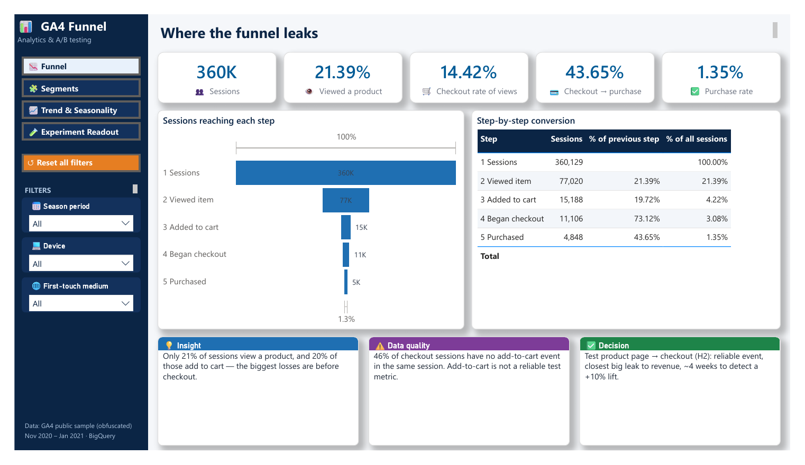
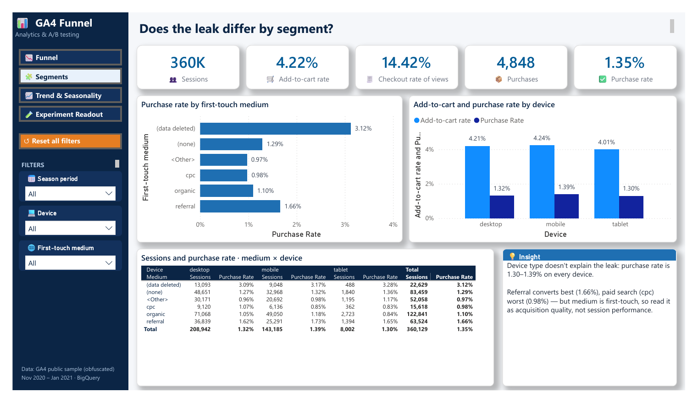
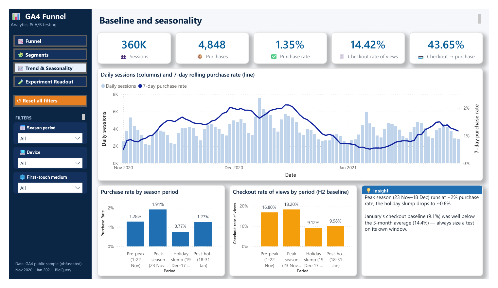
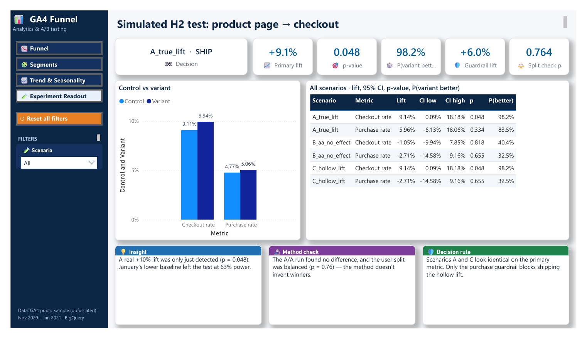

# GA4 E-commerce Funnel Analysis & A/B Test Planning

This project analyses the purchase funnel in the public GA4 e-commerce sample in BigQuery, finds where users drop off, and turns the results into an A/B test plan with sample sizes. The plan accounts for data quality and seasonality.

**Stack:** BigQuery (GoogleSQL), Python (statsmodels, scipy, numpy), Power BI (PBIP, DAX, Power Query)
**Data:** `bigquery-public-data.ga4_obfuscated_sample_ecommerce`, Nov 2020 – Jan 2021

## Dashboard (Power BI)



| Segments | Trend & Seasonality | Experiment Readout |
|---|---|---|
|  |  |  |

It's a 4-page Power BI report saved in PBIP format, with navigation buttons, synced slicers, KPI cards and an insight panel on each page. To open it, see [powerbi/README.md](powerbi/README.md).

## Key findings

1. **The funnel converts 1.35% of sessions to a purchase.** The biggest losses come before checkout: 21.4% of sessions view a product, and 19.7% of those add to cart.
2. **Add-to-cart isn't reliable.** 46% of checkout sessions have no add-to-cart event in the same session, so the test plan uses `begin_checkout` instead.
3. **Device type doesn't explain the leak.** Purchase rates run from 1.30% to 1.39% across devices. By first-touch medium, referral converts best (1.66%) and cpc worst (0.98%).
4. **Seasonality is strong.** The 7-day purchase rate swings about 4x (0.5% to 2.1%) across Black Friday, December and January. Tests must avoid these windows.
5. **Purchase rate can't be tested at this traffic level.** Detecting a 5% lift needs 35 weeks. The recommended test, which measures product-page-to-checkout rate, can detect a 10% lift in 4 weeks.
6. **The test plan was checked with a simulation.** I simulated the recommended test on real January sessions in three versions: a real lift, an A/A run with no change, and a "hollow" lift where extra checkouts never become purchases. The decision rule shipped the real lift, found nothing in the A/A run and blocked the hollow lift. The simulation also showed the planned test was underpowered: January's baseline was lower than the three-month average, so the test had 63% power instead of 80%.

The full plan and results are in [test_brief.md](test_brief.md).

## Repo layout

```
sql/
  01_explore_events.sql    events available in the data
  02_build_sessions.sql    one row per session, plus the add-to-cart data quality check
  03_funnel.sql            step-by-step funnel conversion
  04_segments.sql          conversion by device and first-touch medium
  05_daily_baseline.sql    daily and 7-day rolling purchase rate
  06_simulated_experiment.sql  simulated A/B test (3 scenarios) and per-arm summary
analysis/
  sample_size.py           sample size and duration for each hypothesis
  analyse_experiment.py    user-split check, delta-method z-test, Bayesian P(better), guardrails, decision
  sim_results.csv          per-arm output of sql/06
  results.txt              printed analysis output
powerbi/
  GA4_Funnel_Dashboard.pbip   4-page dashboard: Funnel, Segments, Trend & Seasonality, Experiment Readout
  data/                       CSV extracts used by the dashboard
test_brief.md              hypotheses, recommended test design and decision rule
```

To open the dashboard, see [powerbi/README.md](powerbi/README.md).

## How to run it

1. Create a BigQuery project. Sandbox mode is enough, with no billing.
2. Create a dataset called `ga4_practice` in the **US** location.
3. Replace `YOUR_PROJECT` in each SQL file with your project ID.
4. Run the SQL files in order. File 02 scans about 1.1 GB once, and every query after it runs on the small table it creates.
5. Run the Python scripts:

```
pip install statsmodels scipy numpy
python analysis/sample_size.py
python analysis/analyse_experiment.py
```

## Caveats

- **Obfuscated data:** Google obfuscates this dataset, so it contains placeholder values and has limited internal consistency. Read the rates as a demonstration of the method, not as real business performance.
- **First-touch source:** `traffic_source` holds the user's first-touch source, not the session's source.
